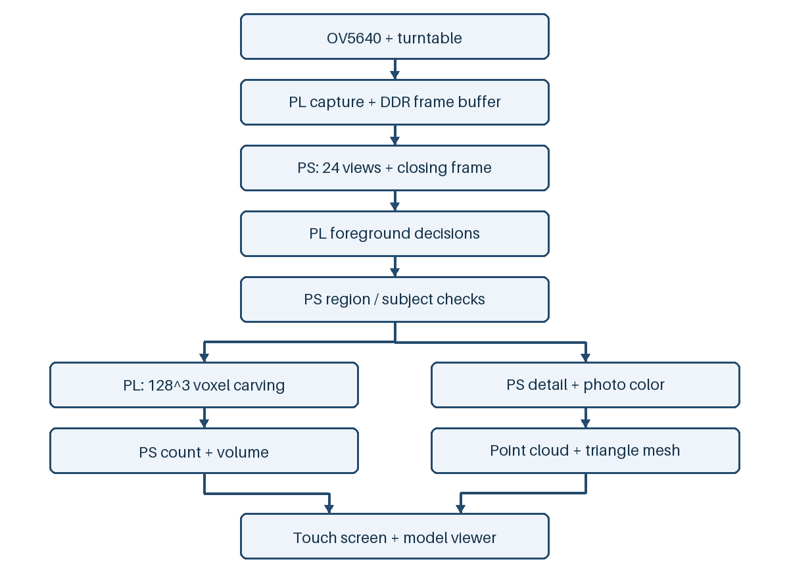

# 基于Zynq-7000的单相机转台三维重建与体积测算系统

本系统基于Zynq-7000，使用单相机与转台完成物体外形重建、体积估算和触摸查看。本文介绍系统原理、软硬件实现、实验结果及开发过程。测试范围见第8节。

## 1. 选题背景与目标

本项目用一台OV5640摄像头和匀速转台采集物体外观，在Zynq-7000上完成轮廓重建、体积估算和模型显示。操作入口包括电脑上的逐格Notebook和实体触摸屏流程。我们将采集、计算、保存和查看集成到同一平台，减少扫描过程中的操作切换。

系统面向教学、外形记录和低成本数字化存档，通过单圈多视角轮廓获取物体可视外表面的三维表示。

## 2. 方法选择

视觉外壳用多个视角的轮廓约束空间，每个体素投影到各张掩模，全部视角均支持时保留。这个方法输入清楚、规则固定，适合在PL上逐体素处理。[Laurentini, 1994](https://doi.org/10.1109/34.273735)讨论了该方法的外形表达能力及其对凹陷的限制。

本项目选用PS/PL协同方案。PS管理标定、转角估计、数据和界面；PL执行反复使用的像素判定、投影与占据更新。单相机和转台降低了硬件复杂度，同时使掩模质量、旋转周期和投影模型成为主要误差来源。

## 3. 设计原理与功能框图（硬件、软件与数据流）

硬件为ACZ702系列开发板、XC7Z020CLG400-1、OV5640、200mm转台、800×480显示屏和GT911触摸控制器。开发使用Vivado 2026.1；实机环境为PYNQ2.4、Python3.6.5、NumPy1.13.3、Pillow5.1.0、SciPy0.19.1及gcc7.3.0。

流程图中PS负责参数、区域处理、计数与模型导出，PL负责采集、像素判定及体素雕刻。GT911触点经PL读取后，由PS处理流程按钮和模型手势。

操作前先通过Jupyter启动逐格或触屏入口，扫描期间保持内核运行。触屏入口由Jupyter启动，随后可在实体屏推进各步骤。每圈保存24张RGB565照片，并额外保存一张闭合帧用于首尾检查。分割PL核通过DMA处理这些已保存数组，结果与相应原图、参考图和配置一同留档。

## 4. 软硬件划分与接口

| 功能 | 执行位置 | 主要输入输出 |
|---|---|---|
| 相机采集、显示输出 | PL | RGB565与DDR帧缓存 |
| 转台标定、周期估计 | PS | 背景、空台照片、标记轨迹和投影参数 |
| 像素强弱判定 | PL | 原图、参考图、LUT和阈值；每像素2位 |
| 主体归属和区域复核 | PS | 强弱位、边缘和颜色证据；最终掩模 |
| 128³体素雕刻 | PL | 24视角掩模、Q16系数；占据数组 |
| 占据计数及体积 | PS | 占据位图和体素边长；输出占据体素数与体积 |
| 256³细化、取色和PLY导出 | PS | 原图、掩模与占据 |
| 触摸查看 | PL＋PS | GT911触点、显示缓存和模型显示副本 |

实际IP地址和数据布局见[接口说明](../board/interfaces.md)。PL雕刻完成后输出占据位图，PS读回并统计占据体素数，再计算体积；OCC_WCNT仅表示占据位图的读回字数。固定相机缓存为0x01800000至0x018BB7FF，加载前由初始化检查Linux内存保留。工程使用FCLK0=50MHz，显示像素时钟计算值为33.333333MHz。

## 5. 采集、标定和掩模

采集前固定镜头、照明和相机参数，分别保存无盘背景及空台。转台几何标定利用两图差异估计盘宽、旋转轴与台面行。归档扫描的标定盘宽为464像素，比例为200/464=0.43103448mm/像素。本次投影参数结合转台尺度、旋转轴和台面行确定。

转速模块跟踪盘沿标记，依据同方向经过的间隔估计平均周期。归档测速记录的accepted周期为23.798617秒/圈。采集使用周期与帧时间安排角度，另外保存闭合帧。

原图和空台送入PL，得到强前景与候选位。PS再完成颜色竞争、区域划分、稀疏证据复核及最大8连通块筛选。保留区域ID和取样顺序是等价优化的条件，因为它们参与后续预算和证据选择。颜色接近背景或细连接丢失时，最大块筛选会放大前序漏判的影响，第10节给出一次具体排查。

## 6. 占据、体积和模型

记第i视角掩模为Mᵢ，体素中心为X，投影为πᵢ(X)。严格占据采用O(X)=∏Mᵢ(πᵢ(X))。PS准备Q16投影系数，PL逐视角更新占据；像素中心和取整约定在参考实现中保持一致。

体积换算为V=N·d³/1000，其中N为占据体素数，d以毫米计，V以cm³计。归档实测的严格网格采用d=0.8898995384mm，N=123392，计算得到V=86.9580811891cm³。200/464=0.43103448mm/像素是标定图像的横向比例。体素边长另由三维网格分配确定：`suggest_voxel_mm`先估计初始间距，`consistent_voxel_mm`再按多视角共同占据的范围选择最终间距。该次扫描的grid_selection记录初始值1.6379310345mm、最终值0.8898995384mm。图像比例和三维采样间距分别记录。PS另输出用于显示的细化外壳和照片着色模型。严格体积与显示外壳体积分别保存，实体屏查看采用独立显示副本。

## 7. 已完成的验证与优化

### 7.1 数字参考与实机输出

原完整提交工程保存了28份输入、输出和环境附件；公开库保留比较表和[原件指纹](../data/evidence_sources.json)，不附这些原始数组。24帧共保存288次PL判定，每次含强前景、候选两个位平面；以相同输入和配置重算整数参考，逐像素差异为0。完整128³占据与直接Q16投影参考也为0差异。逐项数据见[参考比较表](../data/reference_comparisons.csv)。

严格占据123392个体素，体积86.958081cm³；显示外壳118.329679cm³。主PLY为435742顶点、487164面。闭合IoU为0.895225，八步完成记录和结果查看状态已保存。

### 7.2 优化对照

| 项目 | 基线 | 当前实现 | 证据范围 |
|---|---:|---:|---|
| 显示FIFO容量 | 256像素 | 4096像素 | 配置与综合网表 |
| 指定行中断供的错误像素 | 359680/384000 | 0/384000 | 同一压力条件的RTL仿真 |
| 上述空读次数 | 127 | 0 | 仿真计数 |
| LUT | 16253 | 16651 | v87与v99完整实现 |
| 寄存器 | 21706 | 22729 | 同上 |
| BRAM tile | 117 | 118 | 同上 |
| DSP | 6 | 6 | 同上 |

完整实现差异还包含显示监测逻辑。当前内部时序WNS+0.520ns、WHS+0.020ns，完整构建日志与报告保存在原完整提交工程中，其指纹列入归档索引。软件分区组件另有Windows主机同输入5轮对照，标签ID完全一致；原始计时和测量范围详见[优化比较](optimization_comparison.md)。

### 7.3 板上单次耗时记录（不同输入）

| 扫描记录 | 输入 | 第7步整体 | 第8步整体 | 可比较范围 |
|---|---|---:|---:|---|
| 早期摆件 | data/board_run | 750.328s | 596.768s | 该样品的一次扫描 |
| 本次纸盒 | data/board_acceptance/cuboid_606 | 467.179s | 491.087s | 该样品的一次扫描 |

早期摆件的第7步包含150.084s存档，第8步包含429.863s细化、取色和导出，均计入各步整体耗时。表中两行按各自的样品和输入分别登记。

显示优化以FIFO容量为明确变量，由256扩展为4096像素，在同一压力条件下比较错误像素与空读次数。运行bit与源码通过SHA关联，便于按配套版本复现。

### 7.4 近似长方体体积对照与配套上板

我们用直尺测得样品长12.2cm、宽9.2cm、高5.4cm，按近似长方体计算参考体积606.096cm³。一次扫描的严格占据349895体素，边长1.2212607981mm，体积637.3279817cm³，偏差+31.2319817cm³，相对偏差5.152976%。显示外壳体积642.0825091cm³另列，不替代主测量。

本次配套程序、新Noto字模与c563构建配套，40份运行文件SHA一致。八步完成，初始化与导出均为50MHz，同一启动DDR保留覆盖帧缓存；屏幕、按钮及模型旋转缩放有人工确认。第7步467.179s、第8步491.087s，与历史摆件按不同输入分别保存。原始数据、计算方法及退出记录见[体积实验](board_volume_experiment.md)。

## 8. 测试范围

体积对照采用单一样品的一次扫描，以直尺尺寸计算几何近似参考。回投覆盖率中位数93.55%、最低83.63%，原始结果的needs_review与physical_accuracy_verified=false状态保持不变。性能对照覆盖FIFO指定压力仿真与主机分区组件，两次板上耗时按不同输入记录。实体屏操作由现场人工检查，八步完成后以中断方式结束。详细的测量条件、硬件约束和操作记录见[配套实验](board_volume_experiment.md)、[字段说明](../data/board_acceptance/cuboid_606/field_meanings.md)及[验证状态](../known_issues.md)。

## 9. 工程创新与大模型辅助开发

### 9.1 工程创新点

我们围绕低成本三维扫描，完成了采集、计算、模型导出和实体屏操作的集成。工程设计有以下三个特点。

1. **PS与PL协同计算。** 我们将像素强弱判定和多视角体素雕刻放在PL，将标定、区域归属、体积换算和照片着色放在PS。两侧通过固定的数据布局传递图像、判定位和占据结果，便于分别验证。
2. **保留可重放的中间数据。** 我们将同一圈的原图、空台、角度、参数、PL判定位和占据结果关联保存。出现模型缺块时，可以沿数据链检查具体像素和区域判据，再用相同输入比较修改前后的结果。第10.2节给出了连接漏分的排查过程。
3. **统一实体屏操作。** 我们在原扫描程序上增加触摸操作入口，将步骤、用时、体积和模型查看放在同一块屏幕上。触屏入口调用原有采集与计算代码，逐格Notebook保留作调试入口。

### 9.2 提问设计与建议核对

我们根据现有工程确定功能目标、接口约定和验收条件，再将需要检查的代码或局部问题交给AI辅助分析。ChatGPT用于代码检查、故障分析和改进思路讨论，WorkBuddy用于外部复审；历史具体模型版本未记录。核心RTL方面，AI参与方案设计、代码检查与故障分析，工程实现的采用范围依据仿真、构建及板上结果判断。

以下是根据开发过程整理的任务要点，用于说明请求AI协助的范围，不是逐字聊天记录。完整任务摘要见[协作案例](../data/ai_collaboration/README.md)。

**示例一：触屏代码检查与第7步优化思路。**

> 检验触屏功能代码是否存在问题？并提供一个优化第七步生成掩模部分的思路，看看能不能在效果完全不变的情况下改善算法节约时间，20min确实是难以接受

我们已明确检查对象和“效果完全不变”的约束，AI协助发现风险并比较优化方向。方案是否进入运行版本，由同输入结果、计时边界和回退条件决定。

**示例二：在原程序上增加触屏操作入口。**

> 我们想在现有扫描流程和计算接口的基础上，将整个流程由一个代码框实现，通过触屏操作运行下一步，代码可以怎么实现？

这个任务以原有扫描流程和计算接口为基础，讨论如何用一个Notebook代码框启动流程，再由触屏推进各步骤。我们保留原计算入口，结合步骤执行和实体屏操作核对接入结果。

对模型提出的解释，我们会对照原图、数组、错误栈、手册或寄存器读数检查。例如GT911排查中，缺少手册原页时的针位判断没有直接作为结论；后续结合引脚图和实机读回修正。掩模连接复核也保留离线备选与已上板基线的区别。

我们将数字实现一致性、模型形状和独立物理测量分别验证。模型建议采用逐位对照、保留原输入和区分验证层次，这些方法进入了工程检查流程；具体算法修改仍按检查结果取舍。本次606.096cm³参考来自直尺尺寸，单次对照结果不扩展为通用精度承诺。

为展示实际协作过程，我们另选取[三组真实交互片段](../data/ai_collaboration/selected_interactions.md)：团队提出优化方向和退出条件，限定先分析原因并补充现场现象，以及对备选方案提出真实连接约束。片段保留原文，正文任务示例仍为整理稿。它们说明团队提供输入、限定问题并决定取舍，模型辅助排查和核对。

针位排查还保留一条[模型自我纠错原文](../data/ai_collaboration/selected_interactions.md)。模型在取得手册原页后，纠正了先前过早宣布根因的判断；后续按原页导线端点核对针号，并以设备读回核查通信恢复。该段节选自2026-10-28的模型分析记录。

### 9.3 智能体工作流与技能包提炼

开发中，我们先明确问题、输入版本和修改约束，再请AI辅助分析代码与数据、比较备选思路。备选修改通过对应检查后再选择采用，原输入和运行版本保留，便于比较和回退。测试记录分别注明主机重放、RTL仿真或板上实测。

我们把反复使用的检查步骤整理成pynq-integration-checks技能包：先检查bit/hwh配对、器件和IP接口，再核对寄存器对象、DMA布局与缓存所有权，最后比较硬件输出和独立参考。使用步骤、常见故障和失效条件写入SKILL.md及references；文件元数据和数组比较由两个只读脚本完成。

| 工具 | 检查内容 | 使用范围 |
|---|---|---|
| overlay_audit.py | bit/hwh的器件、IP和元数据 | 本地离线检查，按待检查工程指定IP |
| compare_arrays.py | 数组的dtype、shape和逐项差异 | 对照硬件输出与独立黄金参考 |

原完整工程的工具记录包括14项行为检查和5个跨任务、设备元数据夹具案例。源码版不附实测bit/hwh对，当前主机入口执行其余13项行为检查和5个复用案例。实际工程记录来自XC7Z020平台，命令和案例见[技能包说明](../skill/README.md)。

### 9.4 AI建议的采用与取舍

我们根据工程目标安排分析与试验，AI辅助代码检查、故障定位和备选思路比较。建议是否进入工程由已有数据和检查结果决定，下表整理各项辅助内容与我们的取舍。

| 协助要点 | 我们的处理 | 采用依据或未采用原因 |
|---|---|---|
| PL体素雕刻核与PS接口的方案设计、代码检查及故障分析 | 采用PS下发掩模/Q16系数、PL更新占据的分工 | 工程对应voxel_carver、recon_top、recon_axil和ps_demo。tb_recon、投影偏移仿真、完整构建及历史实机128³占据逐位核对分别提供验证。任务范围与采用情况见[协作摘要](../data/ai_collaboration/README.md) |
| PL前景判定的数据布局与强弱位接口检查 | 采用独立整数参考核对输出 | 288次已保存PL调用的两个位平面零差异，确认的是数字实现；颜色相近、连接漏分和三维形状仍由原图与工程记录检查 |
| 将原扫描步骤接入触屏，显示步骤、用时和体积，支持模型查看 | 已采用 | 沿用原扫描计算入口；本次八步完成，按钮、旋转、缩放和显示有人工确认，详见[配套实验](board_volume_experiment.md) |
| 固定Tcl脚本目录并给综合子进程设置单线程 | 已采用 | 子进程读回general.maxThreads=1；独立构建与包内入口均生成bit/hwh，日志和产物SHA见[构建记录](build_reproduction.md) |
| 用阶段日志拆分掩模耗时，再定位PS处理和存档 | 已采用分析方法 | 907.094s记录中DMA等待3.888s；因此保留整体、子阶段和平台范围，未用不同输入宣称整步加速，详见[优化对照](optimization_comparison.md) |
| 将来源未明字模替换为Noto字模，按文件区分许可 | 已采用 | 766字形保留OFL来源；本次配套上板使用该字模。厂家例程仍按专项答复范围提供，自研MIT不覆盖整库 |
| 在缺少手册原页时就确定GT911针序原因 | 未采纳该确定性结论 | 地址NACK只能定位到通信阶段；回查原页并按实际孔序调整后，才结合在线和触点读回确认，详见第10.1节 |
| 将v101局部连接复核直接作为当前分割版本 | 未并入实机版本 | 单帧离线结果改善，但不足以替代完整整圈和三维验证；当前运行40份文件按本次板上SHA选择，详见第10.2节 |
| 用PL逐位零差异代替形状、物理体积精度验证 | 未采用 | 零差异核对的是数字实现；本次另做直尺体积对照，仍保留形状needs_review，详见第7.4、8节 |
| 双姿态采集后自动配准并合并模型 | 退出当前主流程 | 采集与配准操作负担超出本次展示目标；我们要求保留单圈24视角流程 |
| 仅凭文件齐全和构建完成就判定全部提交要求完成 | 已纠正 | 提交清单另查技能、设计报告、参考对照和正式材料；代码包齐全与所有实验完成分别记录 |

### 9.5 工程心得与方法总结

**先把问题定位到具体一层，再决定改什么。** 显示屏、DDR原始帧、保存图片和最终模型属于不同环节。相机帧完整时，屏幕错位应检查显示读出和时钟；协议仿真通过时，触摸离线仍需检查实际接线。把这些层次分开，比反复重跑全部流程更容易找到原因。

**一个局部判断可能放大成整块缺失。** 最大连通块可以去掉杂点，也可能把真实连接漏分后的整块部件删掉。第13张照片的排查需要追到连接像素、强弱位和区域样本门槛，而不是只看最后一张黑白掩模。局部修正有效后，还要检查其他视角和三维结果，再决定是否替换运行版本。

**先记清时间花在哪里，再谈加速。** 界面显示“PL掩模处理”不等于全部时间都由FPGA计算。907秒的记录说明，传输等待、PS处理和存档要分开计时；子阶段已经包含在整体内，不能再次相加。不同样品的耗时变化也不能直接作为优化倍率。

**把可回退的修改和可核对的证据一起保存。** 原图、标定、掩模、占据与源码SHA关联后，算法问题可以复用输入重放；更换bit、字模或入口后，则保留新的配套上板记录。这样既能采纳有效建议，也能退出尚未验证完整的修改。

**验证结论要回答明确的问题。** 本次637.328cm³相对直尺近似参考606.096cm³偏大5.153%，是一项有来源的单次对照；它不能说明任意物体都满足同一精度。数字参考、形状检查、物理测量、性能和功能操作分别报告，后续改进才有可靠依据。

### 9.6 技能的提炼与复用

我们把工程中的固定参数与检查方法分开：IP名、地址、数组字段和目标频率由使用者提供；可复用部分是输入指纹、元数据核对、独立图案检查、逐项比较和失败定位。由此形成两份只读脚本、DMA/布局排查工作流和案例清单。

技能包按“故障来源—可复用操作—验证方法—失效条件”组织。元数据脚本用器件/IP和格式异常检查检测能力；数组脚本用dtype、shape、缺字段及单点破坏检查；另用非扫描设备元数据和数组字段验证是否脱离题目。各项输入、输出、命令与限制见[技能入口](../skill/README.md)，可填写的提问与结果模板见[复用工作表](../skill/pynq-integration-checks/references/reuse_worksheet.md)。

## 10. 实验现场与排错记录

现存记录覆盖2026年10月8日至31日。下列耗时均为程序记录；接线调整的总耗时和人工重试次数未记全。相关记录范围见[现场说明](../data/evidence_sources.json)。

### 10.1 GT911：从零应答到真实触点

触摸屏接好后仍显示离线。初次快照中0x5d、0x14尝试计数为40/39，ACK=0，两个地址均在写设备地址阶段NACK。为定位失败位置，诊断逻辑增加了失败阶段、ID有效位及应答计数；RTL仿真检查协议行为，实际接线通过板上读回核对。

我们最初使用的接线表把屏幕端写成1/4/5/6。回查P1图并按实际孔序核对后，确认最边一排1、2孔没有TP信号，INT、SCL、RST、SDA应为3、6、7、8，旧表少算了一排。按3/6/7/8改接后，下一次测试即识别GT911。恢复读回为0x5d、800×480、errors=0，后续16个快照完成按下(447,349)、移动和(80,293)松手。问题由此定位到屏幕端针序对应错误。

### 10.2 掩模：一处弱连接如何丢掉整块下部

10月28日的一圈诊断中，第13张照片在最大块筛选前存在14192像素主体和7235像素下部。我们从最终掩模向前逐层核对，在(y311,x337)找到连接判据的漏判：原颜色强位为0、候选位为1，空间参考强位为1。源图复核的样本数仅1，原区域门槛要求至少4，连接先被留在弱状态，随后下部被最大块筛掉。

离线v101连接复核方案增加有证据的局部连接复核，同帧得到22245像素、818个连接及邻域像素，PL调用数保持12。这条改动保存在历史试验中，提交运行目录仍采用实机指纹对应的基线。案例的完整阶段图、数组和最终候选日志见[实验记录附件](engineering_history.md)。

### 10.3 耗时：进度栏写PL，时间主要花在哪里

10月25日另一圈第7步记录907.094s，共409个进度事件。24帧有288次PL调用，DMA等待合计3.888s。按进度事件分段，低对比复核及后续处理370.337s、颜色竞争及后续处理312.726s、存档83.702s。细分后，问题从“PL是否卡住”转向PS区域处理、数据组织和写盘。

早期排查从背景差与clean_mask阶段入手，后续阶段日志将耗时细分到颜色竞争、低对比复核和存档。907秒与750秒按各自输入分别存档，子阶段与整体计时保持对应关系。

### 10.4 构建：子进程设置与Tcl路径

全量复现先遇到综合子进程提前退出，临时单线程入口又因切换目录后找不到前置Tcl而失败。之后在cd前固定脚本绝对目录，把单线程设置注册到综合前置阶段，并从子进程日志读回general.maxThreads=1。修正后独立构建和包内脚本冷启动均完成bit/hwh导出。

v87布线报告WNS为+0.100ns，当前v99为+0.520ns，来自两套完整实现。当前报告同时保留CDC和IO检查项。具体来源及失败日志见[构建记录](build_reproduction.md)。

## 11. 复现步骤

1. 将本源码仓库放在新英文路径，按README执行主机检查，公开模块测试使用生成的合成输入。
2. 使用Vivado 2026.1执行build/build_hardware.tcl，输出到新的外部目录，保存时序、资源和bit/hwh。
3. 按board/README准备目标板内存、时钟和接线，将src/runtime配套文件放入运行目录。
4. 选择逐格或触屏入口完成采集、掩模和重建，保留本次RUN_DIR及所有指纹。
5. 对照数字参考与实物参考分别验收。正式提交材料按赛事模板和来源许可整理。

按构建入口生成scan3d.bit/hwh，与src/runtime配套运行软件一同部署。源码、参数和产物通过manifest及板上来源指纹关联。

## 12. 开源发布与许可

项目源码、构建脚本、技能包、设计报告及选定验证记录公开在[GitHub仓库](https://github.com/fireriver31/scan3d-zynq)。本次提交通过版本标签[submission-v29](https://github.com/fireriver31/scan3d-zynq/tree/submission-v29)定位；完整提交SHA、比赛归档SHA及两份文件清单的对应关系见[发布核验文件](https://github.com/fireriver31/scan3d-zynq/releases/download/submission-v29/submission_v29_verification.json)。

项目自研代码和文档采用MIT许可，根LICENSE与licenses/mit.txt提供相同文本，适用文件列于third_party/file_licenses.json。ACZ702例程及修改源码按厂家专项答复提供，PYNQ参考代码保留BSD，新字模保留OFL，AMD配置沿用原适用条款；具体范围见THIRD_PARTY_NOTICES.md。

版本标签配合完整提交SHA和归档SHA用于交叉核对。已发布标签保留原指向，后续修订另建版本；附注标签记录发布说明、作者和日期，标签本身不等同于平台强制禁止变更。

## 13. 参考资料

- A. Laurentini, The Visual Hull Concept for Silhouette-Based Image Understanding, IEEE TPAMI 16(2), 150–162, 1994. DOI: 10.1109/34.273735。
- [PYNQ Overlay设计文档](https://pynq.readthedocs.io/en/latest/overlay_design_methodology/overlay_design.html)。
- 芯路恒ACZ702用户手册与HDL教程第31章、图31-17。原工程书目、接线和寄存器记录的指纹见[归档索引](../data/evidence_sources.json)。
